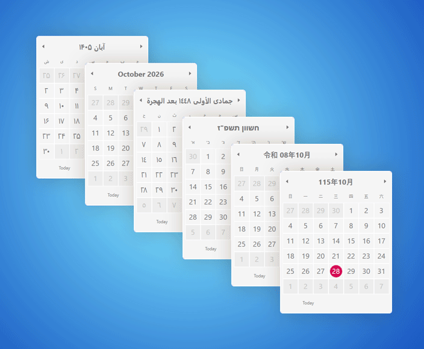
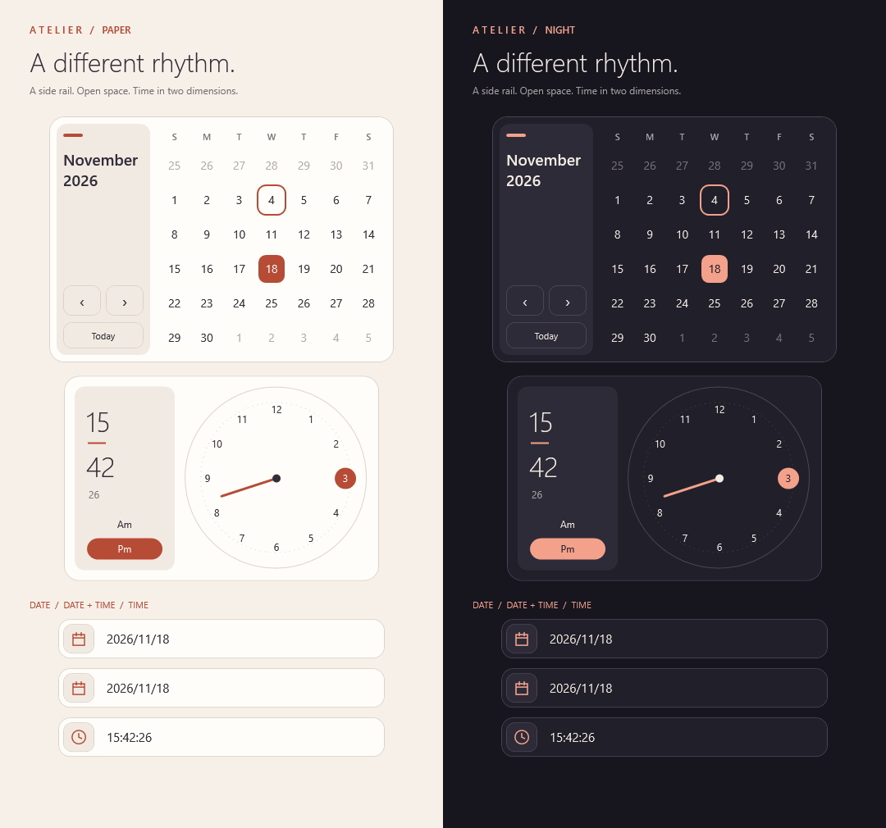
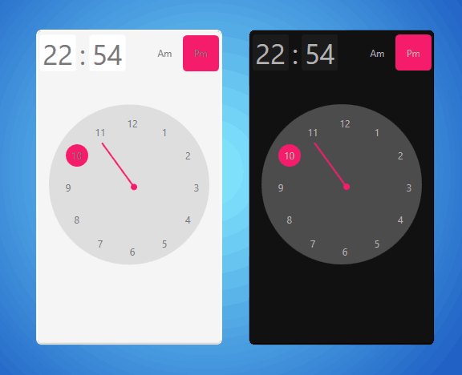
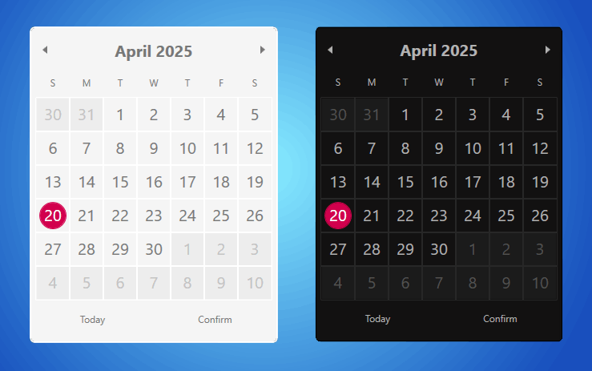
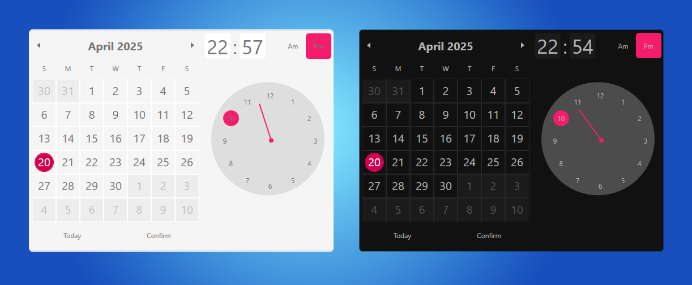
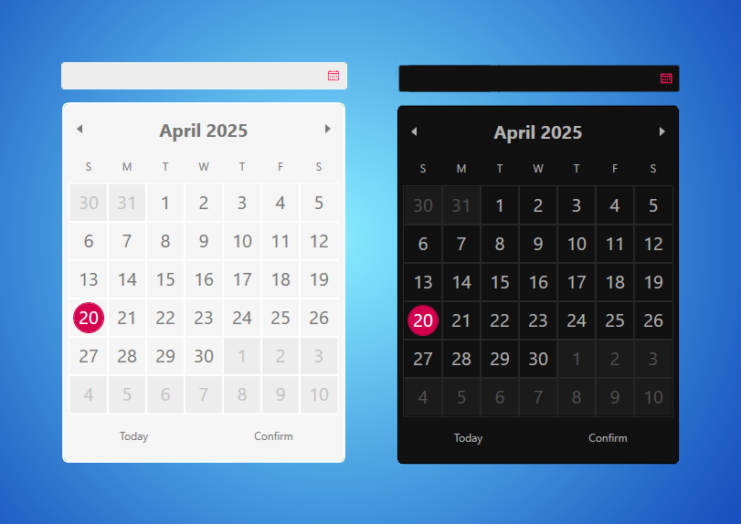
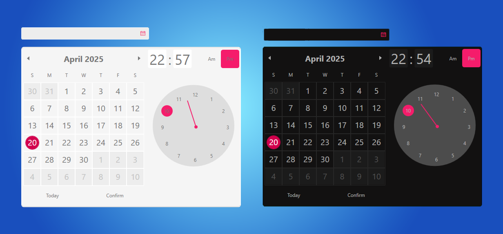
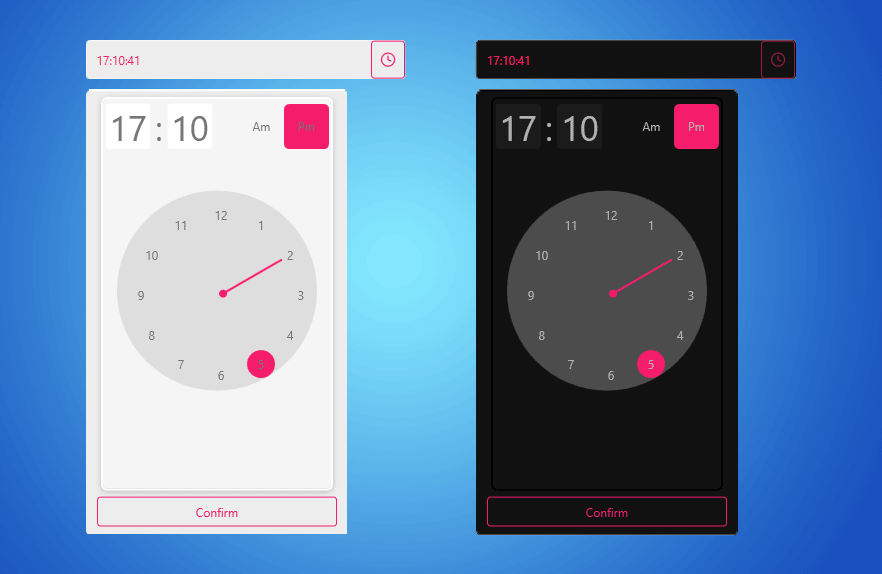
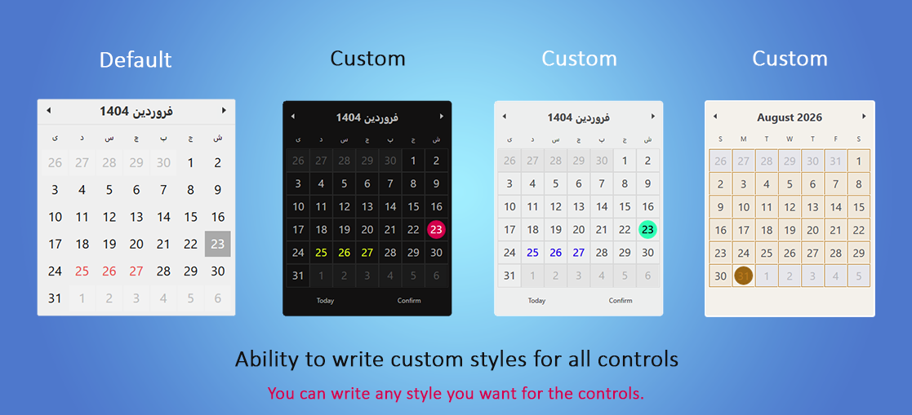
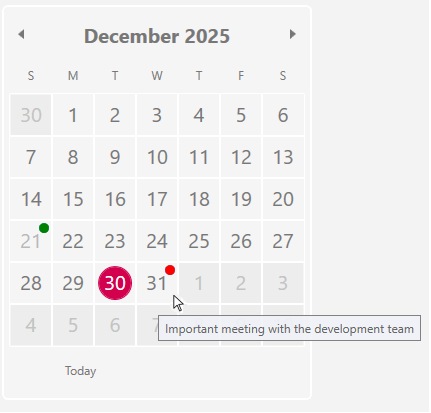

# Persian calendar
## WPF date and time controls with support for eight calendars

- A free WPF calendar library supporting Persian, Gregorian, Hijri, UmAlQura, Hebrew, Thai Buddhist, Japanese, and Taiwan calendars.
- You can write any style you like for the controls.
- Seven built-in UI translations, custom language resources, and runtime theme switching.

## Quick start
Install the package in a WPF application:

```shell
dotnet add package PersianDateTimeWPFTools
```
Optionally merge `InitResources` for named styles, an initial theme and local culture-based language defaults. Default control styles load automatically; static `SetTheme` and language selection APIs work without this merge:
```xml
<Application
    xmlns="http://schemas.microsoft.com/winfx/2006/xaml/presentation"
    xmlns:x="http://schemas.microsoft.com/winfx/2006/xaml"
    xmlns:pdtt="https://github.com/Behnam2064/PersianDateTimeWPFTools"
    StartupUri="MainWindow.xaml">
    <Application.Resources>
        <ResourceDictionary>
            <ResourceDictionary.MergedDictionaries>
                <pdtt:InitResources
                    SelectedTheme="Default" />
            </ResourceDictionary.MergedDictionaries>
        </ResourceDictionary>
    </Application.Resources>
</Application>

```

Add the package namespace and place a control in your window:

```xml
<Window x:Class="MyApp.MainWindow"
        xmlns="http://schemas.microsoft.com/winfx/2006/xaml/presentation"
        xmlns:x="http://schemas.microsoft.com/winfx/2006/xaml"
        xmlns:pdtt="https://github.com/Behnam2064/PersianDateTimeWPFTools"
        Title="Calendar" Width="400" Height="450">
    <Grid>
        <pdtt:PersianCalendar />
    </Grid>
</Window>
```

Replace `MyApp.MainWindow` with your window's class name. 

## Supported calendars

The WPF date controls support eight calendars through `CustomCulture.DateTimeFormat.Calendar`:

| Calendar | .NET calendar class | Culture used in the examples |
|---|---|---|
| Persian (Solar Hijri / Shamsi) | `System.Globalization.PersianCalendar` | `fa-IR` |
| Gregorian | `GregorianCalendar` | `en-US` |
| Hijri | `HijriCalendar` | `ar-SA` |
| UmAlQura | `UmAlQuraCalendar` | `ar-SA` |
| Hebrew | `HebrewCalendar` | `he-IL` |
| Thai Buddhist | `ThaiBuddhistCalendar` | `th-TH` |
| Japanese | `JapaneseCalendar` | `ja-JP` |
| Taiwan | `TaiwanCalendar` | `zh-TW` |

This applies to `PersianCalendar`, `PersianDatePicker`, `PersianCalendarWithClock`, and `PersianDateTimePicker`. Their existing names and selection properties are retained. Calendar selection on these controls does not change the calendar-specific contracts of the Persian/Gregorian services and extension methods documented below.

### Select a calendar explicitly

**`CustomCultureName` selects a culture and its default calendar. It does not guarantee a particular calendar implementation.** For example, `he-IL` can use a Gregorian calendar with Hebrew month/day names. Likewise, `ja-JP`, `ar-SA`, and `zh-TW` alone do not explicitly select Japanese, Hijri, or Taiwan calendars.

To choose a calendar explicitly, create a matching culture, assign its `DateTimeFormat.Calendar`, and pass the **whole culture object** to `CustomCulture`:

```csharp
using System.Globalization;

var hebrewCulture = new CultureInfo("he-IL", false);
hebrewCulture.DateTimeFormat.Calendar = new HebrewCalendar();

calendar.CustomCulture = hebrewCulture;
datePicker.CustomCulture = hebrewCulture;
calendarWithClock.CustomCulture = hebrewCulture;
dateTimePicker.CustomCulture = hebrewCulture;
```

The names `calendar`, `datePicker`, `calendarWithClock`, and `dateTimePicker` refer to controls in your window. Apply the assignment to the controls you use.

> Assigning `CustomCultureName = hebrewCulture.Name` would create a culture again using its default calendar. The `HebrewCalendar` assigned above would not be carried over. Assign `CustomCulture = hebrewCulture` instead, and avoid setting both properties for the same selection.

Use the same pattern for the other calendars:

```csharp
using System.Globalization;

static CultureInfo CreateCalendarCulture(
    string cultureName, System.Globalization.Calendar calendar)
{
    var culture = new CultureInfo(cultureName, false);
    culture.DateTimeFormat.Calendar = calendar;
    return culture;
}

var persian = CreateCalendarCulture(
    "fa-IR", new System.Globalization.PersianCalendar());
var gregorian = CreateCalendarCulture("en-US", new GregorianCalendar());
var hijri = CreateCalendarCulture(
    "ar-SA", new HijriCalendar { HijriAdjustment = 0 });
var umAlQura = CreateCalendarCulture("ar-SA", new UmAlQuraCalendar());
var hebrew = CreateCalendarCulture("he-IL", new HebrewCalendar());
var buddhist = CreateCalendarCulture("th-TH", new ThaiBuddhistCalendar());
var japanese = CreateCalendarCulture("ja-JP", new JapaneseCalendar());
var taiwan = CreateCalendarCulture("zh-TW", new TaiwanCalendar());

// Select one configured culture.
datePicker.CustomCulture = hijri;
```

`HijriAdjustment = 0` explicitly selects the unadjusted Hijri calculation. Set this property on your calendar instance when a different adjustment is required.

For culture defaults, the name-based XAML property remains available:

```xml
<pdtt:PersianCalendar CustomCultureName="fa-IR" />
<pdtt:PersianDatePicker CustomCultureName="en-US" />
```

Without a custom culture, the controls use the culture resolved from their WPF `Language` or the current culture. To change calendar or number-format settings later, assign a newly configured `CultureInfo` to `CustomCulture`; editing the internals of an already assigned instance does not itself raise a WPF dependency-property change notification.

### DateTime values and calendar boundaries

Selected values remain ordinary `DateTime` values:

| Controls | Selection property |
|---|---|
| `PersianCalendar`, `PersianDatePicker` | `DateTime? SelectedDate` |
| `PersianCalendarWithClock`, `PersianDateTimePicker` | `DateTime? SelectedDateTime` |
| `Clock`, `ClockPicker` | `DateTime? SelectedTime` |

`DateTime.Year`, `Month`, and `Day` expose Gregorian components even when a control displays another calendar. Use the active calendar to obtain its components or construct a date:

```csharp
var hebrewCalendar = new HebrewCalendar();
DateTime value = hebrewCalendar.ToDateTime(5784, 1, 15, 0, 0, 0, 0);

datePicker.SelectedDate = value;
int year = hebrewCalendar.GetYear(value);       // 5784
int month = hebrewCalendar.GetMonth(value);     // 1: the selected month
int months = hebrewCalendar.GetMonthsInYear(5784); // 13: months in this year
```

Each calendar has its own supported range. Read `MinSupportedDateTime` and `MaxSupportedDateTime` from that calendar rather than assuming `DateTime.MinValue` and `DateTime.MaxValue` are supported. These boundaries are also `DateTime` values: for the Hebrew calendar, their Gregorian years are 1583 and 2239, while `GetYear` returns Hebrew years 5343 and 5999.

Changing the display culture does not change the selected date/time value into a different `DateTime`. If an existing selection falls outside a requested calendar's range, the date picker controls report a date validation error and retain the previous accepted selection/culture.

### Calendar-specific behavior

- **Hijri and UmAlQura:** Each uses its own .NET calendar calculations and supported range. Explicitly assign the desired calendar even though both examples use `ar-SA`.
- **Hebrew:** Common years have 12 months and leap years have 13. The year view adds a fourth row for the extra month and returns to three rows for a common year with the default templates. The thirteenth month is selectable, and month navigation accounts for the actual number of months. Long-date formatting may use Hebrew letters for numbers as defined by .NET's culture formatting.
- **Thai Buddhist:** Year display uses the Buddhist calendar. Short and long input support five-digit years near the upper `DateTime` boundary.
- **Japanese:** Short dates include the era. If a long-date or month-heading pattern omits the era, it is included in the control's display. For example, April 30, 2019 displays as `平成 31/04/30`, while May 1, 2019 displays as `令和 01/05/01`. A transition year's heading shows both eras; its year view keeps the twelve months in the same chronological year. Year and decade navigation remain chronological across era changes. Era names come from the runtime's calendar data.
- **Taiwan:** Months and leap days follow the Gregorian calendar with a different year numbering; for example, Gregorian 2026 is Taiwan year 115.

For manual input, the short date format is `yyyy/MM/dd`, with an era prefix for Japanese dates. Long dates follow the effective culture's long-date pattern, with the calendar-specific handling described above. Keep the era when entering or copying historical Japanese dates.

## Native digits for dates and times

Set `UseNativeDigits="True"` to display digits from the effective culture's `NumberFormat.NativeDigits`. The default is **`false`**, so Latin digits are not replaced.

The property is available on `PersianCalendar`, `PersianDatePicker`, `PersianCalendarWithClock`, `PersianDateTimePicker`, `Clock`, and `ClockPicker`.

```xml
<pdtt:PersianCalendar CustomCultureName="fa-IR" UseNativeDigits="True" />
<pdtt:PersianDatePicker CustomCultureName="fa-IR" UseNativeDigits="True" />
<pdtt:Clock CustomCultureName="fa-IR" UseNativeDigits="True" />
<pdtt:ClockPicker CustomCultureName="fa-IR"
                  UseNativeDigits="True"
                  TimeFormat="HH:mm" />

<pdtt:PersianCalendarWithClock CustomCultureName="fa-IR" UseNativeDigits="True" />
<pdtt:PersianDateTimePicker CustomCultureName="fa-IR" UseNativeDigits="True" />
```

These examples use culture defaults. For explicit calendar selection, assign the configured `CustomCulture` as shown above, then enable the option:

```csharp
datePicker.CustomCulture = hebrew;
datePicker.UseNativeDigits = true;

// Restore Latin digit display without changing the selected value.
datePicker.UseNativeDigits = false;
```

The setting covers day numbers, calendar headings, year/decade labels, date fields, clock dial numbers, and formatted time text. Composite controls forward the culture and digit option to their nested calendar and clock; `ClockPicker` also applies them to its popup clock. `Clock` and `ClockPicker` inherit `CustomCulture`, `CustomCultureName`, and `UseNativeDigits` from `ClockBase`.

- Toggling digit display does not change the selected date/time or raise a selection-change event by itself.
- Native input digits are normalized before parsing. Persian, Arabic-Indic, and Latin input remain accepted; custom native digits from the assigned culture are supported too.
- Clock calculations and dial selection continue to use numeric values rather than the localized labels.
- Committing unchanged `ClockPicker` text preserves precision hidden by `TimeFormat`, including seconds and fractional ticks. An actual time edit uses the existing parsed-field behavior.
- A culture's native digits may already be Latin. In that case, enabling the option produces no digit-shape change. The property uses `NativeDigits`; it does not invent a separate numeral system.

Calendar culture and digit display are separate from the seven built-in UI translations. Labels such as Today, Confirm, and AM/PM use the language-resource APIs described in [Control language resources](#control-language-resources); selecting a calendar culture does not automatically change those labels.

## Calendar events

Add a single-date event directly to a control, or use the optional provider API for recurring and shared occasions. Event dates are independent of the calendar used for display.

### Add an event without global configuration

Enable event display once on the control:

```xml
<pdtt:PersianCalendar
    x:Name="calendar"
    ShowCalendarEvents="True" />
```

Then add a local event:

```csharp
using System;
using PersianDateTimeWPFTools.Events;

calendar.CalendarEvents.Add(new CalendarEvent
{
    Date = new DateTime(2026, 11, 7),
    Title = "Customer meeting"
});

// Equivalent shorter form:
calendar.CalendarEvents.Add(
    new CalendarEvent(new DateTime(2026, 11, 8), "Follow-up"));
```

No `CalendarEventConfiguration`, provider or rule is required. `CalendarEvents` is available on `PersianCalendar`, `PersianDatePicker`, `PersianDateTimePicker` and `PersianCalendarWithClock`. Each control starts with its own `ObservableCollection<CalendarEvent>` exposed through `IList<CalendarEvent>`. Wrappers forward the same collection to their inner calendar.

`ShowCalendarEvents` retains its existing default of `false` and controls both local and configured events. Adding an event does not change that property or replace its binding.

### XAML

The package's existing XML namespace also includes `CalendarEvent`:

```xml
<pdtt:PersianDatePicker
    xmlns:pdtt="https://github.com/Behnam2064/PersianDateTimeWPFTools"
    ShowCalendarEvents="True">
    <pdtt:PersianDatePicker.CalendarEvents>
        <pdtt:CalendarEvent
            Date="2026-11-07"
            Title="Customer meeting" />
    </pdtt:PersianDatePicker.CalendarEvents>
</pdtt:PersianDatePicker>
```

### MVVM and live updates

```csharp
using System.Collections.ObjectModel;
using PersianDateTimeWPFTools.Events;

public ObservableCollection<CalendarEvent> Meetings { get; }
    = new ObservableCollection<CalendarEvent>();
```

```xml
<pdtt:PersianDateTimePicker
    ShowCalendarEvents="True"
    CalendarEvents="{Binding Meetings}" />
```

Add/remove/replace/clear operations on a notifying collection update the UI. Editing a `CalendarEvent`'s Date, Title, Id or Priority also updates the UI; no manual refresh is needed. Replacing the bound collection works when the view model raises PropertyChanged for its collection property. Perform collection and item edits on the UI dispatcher thread, as with other WPF-bound UI data.

```csharp
var meeting = new CalendarEvent(new DateTime(2026, 11, 7), "Meeting");
Meetings.Add(meeting);
meeting.Title = "Rescheduled meeting";
meeting.Date = new DateTime(2026, 11, 8);
Meetings.Remove(meeting);
```

A plain `List<CalendarEvent>` can be assigned, but it does not notify collection changes. After changing that list, call `RefreshCalendarEvents()`; it also discovers any newly added items. Use `ObservableCollection<CalendarEvent>` for automatic updates.

Dates are Gregorian `DateTime` values identifying a day, independent of the calendar used to display it. The time portion is discarded. IDs are generated automatically; supply an existing business ID if useful. Empty/whitespace titles represent drafts and are not rendered until a title is supplied. Null entries are ignored. Higher Priority values sort first, then IDs in ordinal order.

### Existing providers and recurrence

The existing configuration/provider API remains available for calculated occasions, recurrence and shared application data. Local events and configured provider occurrences are combined. For the same date and ID, the first local event takes precedence over the provider occurrence; removing it reveals the provider occurrence again. Different IDs on one date remain separate events, even with the same title.

Local `CalendarEvent` represents one date. Existing `CalendarEventDefinition` and `CalendarEventRule` types remain the advanced recurrence path. `CalendarEventTemplate`, `ShowCalendarEventToolTips`, `ShowCalendarEventHighlights` and `CalendarEventHighlightStyle` apply to both sources.

Local collection/item edits reuse the provider's cached visible-range result. Navigation, provider configuration changes and an explicit `RefreshCalendarEvents()` can query it again.

### Optional shared occasions

For application-wide occasions, configure a provider and enable `ShowCalendarEvents` on the controls that should display them. Local events do not require this step.

```csharp
using PersianDateTimeWPFTools;
using PersianDateTimeWPFTools.Services.CalendarEvents;

CalendarEventConfiguration.Configure(options =>
    options.EventProvider = new IranianCalendarEventProvider());
```

The default provider is empty and no region is assumed. The Iranian preset supplies recurring occasions; inspect `CreateDefaultEvents()` or `Events` for the definitions included in your version. It is calculated event data, independent of official holiday and working-day policies. Custom recurrence rules can select their own source calendar, as below.

### Define recurring or shared events with a provider

```csharp
using System;
using System.Globalization;
using PersianDateTimeWPFTools;
using PersianDateTimeWPFTools.Events;
using PersianDateTimeWPFTools.Services.CalendarEvents;

var definitions = new[]
{
    new CalendarEventDefinition("my.nowruz", "Nowruz",
        new AnnualCalendarEventRule(new System.Globalization.PersianCalendar(), 1, 1)),
    new CalendarEventDefinition("my.ashura", "Ashura",
        new AnnualCalendarEventRule(new HijriCalendar { HijriAdjustment = 0 }, 1, 10)),
    new CalendarEventDefinition("my.meeting", "Personal meeting",
        new FixedCalendarEventRule(new DateTime(2026, 3, 21)))
};

CalendarEventConfiguration.Configure(options =>
    options.EventProvider = new RuleBasedCalendarEventProvider(definitions));
```

An annual rule takes **calendar, month, day**. Built-in annual rules support Persian, Gregorian, Hijri, and UmAlQura source calendars. The calendar is cloned when the rule is constructed; subsequent changes to the caller's calendar do not change existing rules.

Events from all these source calendars can be displayed on any of the eight supported display calendars. Japanese, Hebrew, Buddhist, and Taiwan display does not require annual rules in those calendars. For other recurrence systems, implement `CalendarEventRule` or supply a custom `ICalendarEventProvider`.

`FixedCalendarEventRule` is a one-date event. Event dates are date-only: time-of-day and time-zone conversion are outside this API.

Invalid annual dates are skipped by default, for example February 29 in a common year or Esfand 30 in a non-leap Persian year. Clamping must be explicit:

```csharp
var rule = new AnnualCalendarEventRule(new GregorianCalendar(), 2, 29,
    InvalidCalendarEventDateBehavior.ClampToLastDay);
```

Clamping is explicit; no silent adjustment is applied to ordinary annual rules. Impossible month/day definitions are rejected unless clamping is requested.

### Edit or remove predefined occasions

Definitions are immutable snapshots with stable, case-sensitive IDs. Copy the set to customize it; the preset and other controls are not mutated:

```csharp
using System.Linq;

var definitions = IranianCalendarEventProvider.CreateDefaultEvents()
    .Where(e => e.Id != "ir.solar.nowruz-1")
    .ToList();

definitions.Add(new CalendarEventDefinition(
    "ir.solar.nowruz-1", "My Nowruz title",
    new AnnualCalendarEventRule(new System.Globalization.PersianCalendar(), 1, 1)));

CalendarEventConfiguration.Configure(options =>
    options.EventProvider = new RuleBasedCalendarEventProvider(definitions));
```

Inspect `CreateDefaultEvents()` or the provider's `Events` property to discover IDs. IDs must be unique within a `RuleBasedCalendarEventProvider`. Replacing a title does not require changing the ID. Definitions can also be replaced with fixed-date or custom rules.

### Query configured provider events without a WPF control

These queries return configured provider events. Per-control `CalendarEvents` collections are local to their controls and are not added to the global service.

```csharp
var services = CalendarEventConfiguration.Services;
var todayEvents = services.GetEvents(DateTime.Today);
var monthEvents = services.GetEvents(
    new DateTime(2026, 3, 1), new DateTime(2026, 4, 1));
```

Ranges are start-inclusive and end-exclusive. Start is normalized to its date; the exclusive end must be midnight. `DateTime.MaxValue` is a special final boundary so that `GetEvents(DateTime.MaxValue.Date)` is supported. All occurrences contain a date and their definition, ID, and title. Multiple events on one date are retained and ordered by descending `Priority`, then ordinal ID.

Custom providers implement the same range contract and must be safe for concurrent reads. Their `GetEvents` method is synchronous; load external data before supplying it to the display path. The built-in providers do not perform I/O.

`Configure` publishes a new service snapshot; loaded calendars refresh on their UI dispatcher. Hidden popup calendars refresh when loaded. `Reset()` returns to the empty provider and refreshes loaded calendars. For a custom provider whose internal data changes without a configuration update, call `RefreshCalendarEvents()` on the relevant date control from its UI thread.

### Tooltip and event highlight

`DayMetadata` supplies per-day tooltips and indicators. When events are enabled:

- Existing tooltip content appears first, followed by the day's event titles.
- A `CalendarDayInfo.ToolTipTemplate` applies to the original tooltip content, not to the event list. `DayToolTipTemplate` supplies the shared default when no per-day template is specified.
- Existing user indicators remain independent of the new event highlight.
- Events do not alter `SelectedDate`, `SelectedDateTime`, blackout dates, working-day services, or enabled state.
- Disabled-day tooltip behavior continues to follow `CalendarDayInfo.ShowToolTipWhenDisabled`.

Arbitrary tooltip data and templates are supported. An explicit `ToolTip` object's body is temporarily presented inside the combined tooltip while open and restored when it closes; the metadata dictionary and original tooltip reference are not replaced. Application-specific tooltip subclasses with custom opening behavior should be tested with composition or displayed through a custom event template.

| Property on the four date controls | Default | Purpose |
|---|---|---|
| `CalendarEvents` | Independent observable collection | Local single-date events; supports binding |
| `ShowCalendarEvents` | `false` | Enable local and provider event presentation |
| `ShowCalendarEventToolTips` | `true` | Append events to the existing tooltip |
| `ShowCalendarEventHighlights` | `true` | Show the independent layer behind the day number |
| `CalendarEventHighlightStyle` | `null` | Optional style targeting `Border` |
| `CalendarEventTemplate` | `null` | Optional tooltip item template for each `CalendarEventOccurrence` |

The two presentation switches have an effect only while `ShowCalendarEvents` is enabled.

```xml
<pdtt:PersianCalendar ShowCalendarEvents="True">
    <pdtt:PersianCalendar.CalendarEventHighlightStyle>
        <Style TargetType="Border">
            <Setter Property="Background" Value="#182196F3" />
            <Setter Property="CornerRadius" Value="5" />
            <Setter Property="Margin" Value="3" />
        </Style>
    </pdtt:PersianCalendar.CalendarEventHighlightStyle>
    <pdtt:PersianCalendar.CalendarEventTemplate>
        <DataTemplate>
            <TextBlock Text="{Binding Title}" TextWrapping="Wrap" />
        </DataTemplate>
    </pdtt:PersianCalendar.CalendarEventTemplate>
</pdtt:PersianCalendar>
```

All seven built-in themes have the event layer between their backgrounds and day text. Existing custom day-button styles are not replaced. A fully custom day-button `ControlTemplate` must add its own layer or use the attached state:

- `CalendarDayButtonExtensions.CalendarEvents`: the day's occurrence list.
- `CalendarDayButtonExtensions.ShowCalendarEventHighlight`: whether the built-in highlight should be shown.
- `CalendarDayButtonExtensions.CalendarEventHighlightStyle`: the selected highlight style.

Use `DayMetadata` for per-day presentation. The former separate tooltip and indicator dictionaries remain compatibility APIs with non-error deprecation warnings; their usage guides have been retired.

## ClockPicker

`ClockPicker` combines an editable time field with the existing `Clock` in a popup. It derives from `ClockBase` and keeps the same `DateTime? SelectedTime`, `DateTime DisplayTime`, `TimeFormat`, `SelectedTimeChanged` and `Confirmed` contracts.

```xml
<pdtt:ClockPicker SelectedTime="{Binding AppointmentTime}"
                  TimeFormat="HH:mm:ss"
                  Watermark="Select a time" />
```

Use a `DateTime?` view-model property; selection binds two-way by default. The control edits the time of day while preserving the selected/displayed date and `Kind`. Default styles work without initialization, and all seven built-in themes are supported.

- Type a time and press Enter, or open the popup and use the clock. Seconds are optional: `14:30` is accepted with the default `HH:mm:ss` format and displayed as `14:30:00`.
- Clock interactions update the selection immediately. Escape restores the value captured on opening; closing by clicking outside keeps the current value.
- The confirmation button or Enter in the popup confirms the displayed time and closes it. `ShowConfirmButton="False"` hides the footer.
- Empty text clears the selection. Invalid text raises `TimeValidationError` and restores the previous formatted value.
- Supported formats include `HH:mm`, `HH:mm:ss`, `hh:mm tt`, `HH:mm:ss.fff`, `t` and `T`. Formatting/parsing use the effective culture selected by `CustomCulture`, `CustomCultureName`, or the culture fallback. Persian and Arabic-Indic input digits are accepted; `UseNativeDigits` enables localized digit display. Date-bearing formats are rejected.
- `IsReadOnly`, `ClockStyle`, `ConfirmButtonContent` and `Watermark` support customization. Explicit styles keep WPF's normal precedence.
- F4 or Alt+Down toggles the popup. Escape cancels popup changes; Tab continues focus navigation.
- UI Automation Value and ExpandCollapse patterns are supported.

`Text` validates immediately when set programmatically; editor typing is committed on Enter, focus loss or opening the popup. Text that already matches the formatted selection retains hidden precision; changed text uses the parsed fields (for example, editing an `HH:mm` value resets seconds to zero).

For localized AM/PM and confirmation labels, call `InitResources.SetLanguage`, `SetLanguageFromCulture` or `SetLanguageResources`; see [Control language resources](#control-language-resources). `ClockBase.AmDesignator` and `PmDesignator` provide English fallbacks when no language resources are applied. The default confirmation label is also available without initialization.

## Themes and resources

### Select a startup theme

To select an application-wide theme, merge one `InitResources` instance into `App.xaml`:

```xml
<Application x:Class="MyApp.App"
             xmlns="http://schemas.microsoft.com/winfx/2006/xaml/presentation"
             xmlns:x="http://schemas.microsoft.com/winfx/2006/xaml"
             xmlns:pdtt="https://github.com/Behnam2064/PersianDateTimeWPFTools"
             StartupUri="MainWindow.xaml">
    <Application.Resources>
        <ResourceDictionary>
            <ResourceDictionary.MergedDictionaries>
                <pdtt:InitResources SelectedTheme="LightModern1" />
            </ResourceDictionary.MergedDictionaries>
        </ResourceDictionary>
    </Application.Resources>
</Application>
```

Replace `MyApp.App` with your application's class name. Omit `SelectedTheme` to keep the default theme. `InitResources` also exposes the package's named styles and language resources. Merge it once; do not also merge `Resources.xaml` directly.

| Theme | Enum value | Theme class |
|---|---|---|
| Default | `BaseThemeName.Default` | `ThemeDefault` |
| ✨ Atelier Light  | `BaseThemeName.LightAtelier` | `ThemeLightAtelier` |
| ✨ Atelier Dark | `BaseThemeName.DarkAtelier` | `ThemeDarkAtelier` |
| Dark Modern | `BaseThemeName.DarkModern1` | `ThemeDarkModern1` |
| Light Modern | `BaseThemeName.LightModern1` | `ThemeLightModern1` |
| Dark Classic | `BaseThemeName.DarkClassic` | `ThemeDarkClassic` |
| Light Classic | `BaseThemeName.LightClassic` | `ThemeLightClassic` |

### Default date-picker input layout

In the Default theme, `PersianDatePicker` and `PersianDateTimePicker` share the same input template, default font size, padding and content alignment. The outer control draws the border once; the transparent inner editor and calendar button occupy separate columns inside it. `Height`, `Width`, `BorderThickness`, typography and `Padding` are forwarded without adding an inner minimum height or a second border.

```xml
<pdtt:PersianDatePicker Height="30" Padding="8,2"
                      BorderThickness="1" Margin="0" />
<pdtt:PersianDateTimePicker Height="30" Padding="8,2"
                          BorderThickness="1" Margin="0" />
```

Remove margins previously used only to compensate for missing bottom borders or vertical offsets, then use the same height, font and padding on neighboring fields. Nonuniform border thickness, such as `1,1,1,3`, is supported without a negative margin. Header and description content have their own rows; allow additional height or use automatic height when displaying them. For a very small fixed height, choose padding and font size that fit its interior, as with a normal WPF TextBox.

The shared template applies to the Default theme. Classic, Modern1 and Atelier retain their own layouts. A consumer style that replaces `Template` must incorporate the layout fix itself; a property-only style continues to use the corrected default template. Popup editing, selection bindings and calendar behavior use the existing control implementations.

### Automatic default resources

`Themes/Generic.xaml` loads the six default control styles and their dependencies without modifying `Application.Resources`. You do not need to merge `InitResources` or call `SetTheme` to get complete default visuals. Named optional themes are loaded through the explicit resource/theme APIs.

The default palette, typography, editor spacing, icon font and focus/context-menu resources are supplied in `DefaultThemeResources.xaml` and `DefaultThemePalette.xaml`. Default theme styles own fallback resources in their style resource scope, following WPF resource lookup. Customize public properties such as `Background`, `Foreground`, `BorderBrush` and `Padding`, or place token overrides in the control's `Resources` when overriding these fallbacks. Application-level string token overrides do not outrank resources in a closer style scope.

Translations are deliberately excluded from these fallback dictionaries so `SetLanguage` and `SetLanguageResources` can update controls after they are displayed. English fallback labels remain usable without initialization. `InitResources` is still available for named styles, an initial selected theme and local culture-based language defaults.

### Switch themes at runtime

Call `SetTheme` on the application's UI thread after the WPF `Application` has been created, for example in a button handler or `OnStartup`:

```csharp
using PersianDateTimeWPFTools.Themes;
using PersianDateTimeWPFTools.Tools;

InitResources.SetTheme(new ThemeDarkModern1());

// Switch again without recreating controls.
InitResources.SetTheme(new ThemeLightClassic());

// Return to the default appearance.
InitResources.SetTheme(new ThemeDefault());
```

These calls demonstrate alternatives; call the one matching the user's selection. Existing and newly created controls use the selected theme through implicit styles. Theme changes replace the library's active resource dictionary and preserve the selected language.

`SetTheme` works without merging `InitResources` first. It requires a WPF `Application` and its UI thread. Passing `null` or an invalid theme is rejected. `SelectedTheme` and `InitResources.Theme` represent application-wide state; setting `SelectedTheme` on a merged instance uses the same theme-switching API. Independent themes for individual windows are not provided by this API.

### Custom styles and resource precedence

The controls no longer assign a local `Style` in their constructors. Explicit styles and implicit styles defined closer to a control retain WPF's normal precedence. Direct entries in `Application.Resources` take precedence over merged dictionaries; later merged dictionaries take precedence over earlier ones.

To follow application-wide theme changes, leave the control's `Style` unset. An explicitly assigned named style stays assigned when the theme changes. Existing named style keys remain available through `InitResources` for applications that intentionally choose a fixed style.

For example, this explicit style preserves the default template while customizing a property:

```xml
<Window.Resources>
    <Style x:Key="LargeCalendar" TargetType="{x:Type pdtt:PersianCalendar}">
        <Setter Property="FontSize" Value="18" />
    </Style>
</Window.Resources>

<!-- Place inside the window's content. -->
<pdtt:PersianCalendar Style="{StaticResource LargeCalendar}" />
```

The example's style remains in place during theme changes. For customization that follows the active theme, prefer setting individual control properties instead of assigning a fixed `Style`.

### Atelier: a different layout (✨New Theme)

Atelier adds paired LightAtelier and DarkAtelier styles for all six controls. The calendar uses a navigation rail beside the date grid; the clock places large hour/minute fields beside its dial. Date/time composites stack the calendar over the clock, and picker buttons move to the leading edge.

```csharp
InitResources.SetTheme(new ThemeLightAtelier());
// Or: InitResources.SetTheme(new ThemeDarkAtelier());
```

For XAML initialization, use `<pdtt:InitResources SelectedTheme="LightAtelier" />`. For a fixed style, use a named resource such as `PersianCalendarDarkAtelier` after merging InitResources; explicitly assigned styles remain fixed during global theme changes.

Allow at least 420 device-independent pixels for the calendar. The stacked date/time popup is taller than the existing side-by-side themes; leave room for it in the host window. The split clock shows 24-hour hours, minutes and seconds independently of TimeFormat separators; its hidden formatted value and the time picker's editor continue to use their own TimeFormat. Native digits, translations, right-to-left calendar layout, Hebrew leap-year month rows, event highlights and metadata remain supported. Clock layout stays left-to-right so the dial and numeric fields retain their spatial order.

### Theme notifications

```csharp
using System;
using PersianDateTimeWPFTools.Tools;

InitResources.OnTheme += HandleThemeChanged;

// Unsubscribe when the subscriber no longer needs notifications.
InitResources.OnTheme -= HandleThemeChanged;

void HandleThemeChanged(object sender, ThemeChangedEventArgs e)
{
    Console.WriteLine($"Theme changed from {e.OldTheme.Theme} to {e.NewTheme.Theme}");
}
```

`OnTheme` is a static event, raised after a successful theme change. Its sender is `null`. Manage subscriptions for the subscriber's lifetime. The controls update through resource lookup and do not need to subscribe to this event.

## Control language resources

The library includes seven UI translations:

| Language | Code | Example culture |
|---|---|---|
| English | `en` | `en-US` |
| Persian | `fa` | `fa-IR` |
| Arabic | `ar` | `ar-SA` |
| Hebrew | `he` | `he-IL` |
| Thai | `th` | `th-TH` |
| Japanese | `ja` | `ja-JP` |
| Traditional Chinese | `zh-Hant` | `zh-TW`, `zh-HK` |

These resources supply four UI labels: `AmText`, `PmText`, `ConfirmText`, and `TodayText`. Calendar selection, month/day names, date/time formatting and native digits are controlled separately by the effective culture and the control's properties. Choosing a calendar culture does not automatically change the library's label resources. Language selection does not change `CurrentCulture`, `CurrentUICulture` or `FlowDirection`.

### Select a language explicitly

Use the static API on the application's UI thread. A WPF `Application` must exist; no `InitResources` instance needs to be created or merged first:

```csharp
using PersianDateTimeWPFTools.Tools;

InitResources.SetLanguage("fa");
// Other examples:
// InitResources.SetLanguage("ar");
// InitResources.SetLanguage("ja-JP"); // Resolves to ja.
// InitResources.SetLanguage("zh-Hant");
```

Language codes are case-insensitive. Regional culture names resolve through their culture parents. An unsupported explicit selection throws `ArgumentException` without changing the active language. Existing consumers of these labels through `DynamicResource` update when the selected language changes. Switching themes preserves the selected language.

For initialization in code:

```csharp
using System.Windows;
using PersianDateTimeWPFTools.Tools;

public partial class App : Application
{
    protected override void OnStartup(StartupEventArgs e)
    {
        InitResources.SetLanguage("fa");
        base.OnStartup(e);
    }
}
```

### Select from Culture

To select once from `CultureInfo.CurrentUICulture`, or from an explicit culture:

```csharp
using System.Globalization;
using PersianDateTimeWPFTools.Tools;

InitResources.SetLanguageFromCulture();

// Alternatively, choose a culture explicitly.
InitResources.SetLanguageFromCulture(new CultureInfo("he-IL"));
```

Supported cultures resolve to the translations above; unsupported cultures fall back to English. This is a one-time selection, not a subscription to later culture changes, and does not search for external translation files. Set `CurrentUICulture` before calling the parameterless method if it should use your application's UI culture.

Traditional Chinese cultures such as `zh-TW`, `zh-HK` and `zh-MO` resolve through `zh-Hant`. Simplified Chinese (`zh-Hans`, `zh-CN`) and neutral `zh` have no built-in translation and fall back to English in automatic selection. Supply custom resources to support these or other languages.

When constructed, `InitResources` uses the same culture resolver for its local language defaults. Constructing a dictionary alone does not modify `Application.Resources`; merge it if you want to use those local defaults. An explicit static language selection takes precedence over instance defaults. Without a merged dictionary or a static selection, the default resource fallback is English.

### Custom language dictionaries

Create a WPF resource dictionary with the supported keys. For example, add `Lang.es.xaml` to your application with build action `Page`:

```xml
<ResourceDictionary
    xmlns="http://schemas.microsoft.com/winfx/2006/xaml/presentation"
    xmlns:x="http://schemas.microsoft.com/winfx/2006/xaml"
    xmlns:sys="clr-namespace:System;assembly=mscorlib">
    <sys:String x:Key="AmText">a. m.</sys:String>
    <sys:String x:Key="PmText">p. m.</sys:String>
    <sys:String x:Key="ConfirmText">Confirmar</sys:String>
    <sys:String x:Key="TodayText">Hoy</sys:String>
</ResourceDictionary>
```

Load it directly, replacing `MyApp` with the assembly containing the dictionary:

```csharp
using System;
using PersianDateTimeWPFTools.Tools;

InitResources.SetLanguageResources(new Uri(
    "pack://application:,,,/MyApp;component/Lang.es.xaml",
    UriKind.Absolute));
```

The overload accepting `ResourceDictionary` is useful for translations created in code:

```csharp
using System.Windows;
using PersianDateTimeWPFTools.Tools;

InitResources.SetLanguageResources(new ResourceDictionary
{
    ["ConfirmText"] = "Confirmar",
    ["TodayText"] = "Hoy"
});
```

Only the four supported labels are copied. Missing labels fall back to English, unrelated keys are ignored, and supplied values must be strings. Reapply the dictionary after changing its contents; it is not observed for later edits. Loading or validation failures preserve the current language. Run both overloads on the application's UI thread.

Direct entries in `Application.Resources` and resources closer to a control retain normal WPF precedence over the library's merged resources. An explicit language selection survives replacement of `Application.Resources` when the replacement includes `InitResources`; otherwise, apply the static language API again after replacing the resources.

### Migrating from ChangeLanguage

`ChangeLanguage` is obsolete with a compiler warning and retains its existing local-dictionary behavior. Replace global language selection with the static APIs:

```csharp
// Built-in language:
InitResources.SetLanguage("fa");

// Custom dictionary: use SetLanguageResources(new Uri(...)).
// Current UI culture: use SetLanguageFromCulture().
```

The static APIs remove the need to find or keep a merged instance for global language selection. The obsolete instance method does not attach an unmerged dictionary to the application, and its local language does not override an explicit global selection.

## Migration: resources and theming

- Default styles now load automatically. Remove initialization used only to make the default controls visible.
- Keep one merged `InitResources` instance if you need named styles or local culture-based language defaults. Static theme and language selection work without merging an instance. Do not depend on the constructor to modify application resources.
- `ChangeLanguage` is obsolete. Use `SetLanguage` for a built-in translation, `SetLanguageFromCulture` for one-time culture selection, or `SetLanguageResources` for a custom dictionary.
- `OnTheme` is now an event: subscribe with `+=` and unsubscribe with `-=`. Direct assignment and invocation from consumer code are no longer supported; the sender is now `null`.
- `ThemeChangedEventArgs.OldTheme` now contains the previous theme.
- `InitResources(bool noInit)` is obsolete. Use the parameterless constructor.
- Review explicitly assigned styles if controls should follow runtime theme changes; those styles retain their normal precedence.


## Date and calendar APIs

The date helpers can be used without instantiating a WPF control. The package still targets the Windows frameworks listed in the project. Examples below assume `DateTime date` and `DateTime other` are available; asynchronous examples belong in an async method or command.

### Persian parsing, formatting and components

```csharp
using System;
using PersianDateTimeWPFTools;
using PersianDateTimeWPFTools.Extensions.Persian;

bool parsedDate = PersianDateTime.TryParse("1405/07/30", out DateTime valueDate);
bool parsedDateTime = PersianDateTime.TryParse("1405/07/30 15:30", out DateTime valueDateTime);
bool exact = PersianDateTime.TryParseExact("1405/07/30", "yyyy/MM/dd", out DateTime exactValue);
string text = date.ToPersianString("yyyy/MM/dd");
string persianDigits = date.ToPersianString("yyyy/MM/dd", usePersianDigits: true);
int year = date.GetPersianYear();
string monthName = date.GetPersianMonthName();
string dayName = date.GetPersianDayName();
var parts = date.GetPersianDateTimeParts();
TimeSpan exactTime = parts.TimeOfDay;
DateTimeKind kind = parts.Kind;
```
### Parser Default Formats Supported
|Predefined format| Format | Result |
|--|--|--|
| d | yyyy/MM/dd |1405/07/30|
| D | dddd dd MMMM yyyy |پنجشنبه 30 مهر 1405|
| t | HH:mm |00:49|
| T | HH:mm:ss |00:50:23|
| g | yyyy/MM/dd HH:mm |1405/07/30 00:51|
| G | yyyy/MM/dd HH:mm:ss |1405/07/30 00:51:05|
| s | yyyy-MM-ddTHH:mm:ss |1405-07-30T00:51:05|


`PersianDateTimeParts` is immutable and includes year, month, day, hour, minute, second, millisecond, the original time of day at tick precision, and `Kind`. No time zone conversion is performed. `Kind` is not a time zone identifier or an offset.

```csharp
DateTime nextMonth = date.AddPersianMonths(1);
DateTime changedYear = date.WithPersianYear(1404);
DateTime changedMonth = date.WithPersianMonth(7, InvalidDayHandling.Throw);
DateTime changedDay = date.WithPersianDay(15);
bool sameMonth = date.IsInSamePersianMonth(other);

foreach (DateTime item in date.EnumeratePersianMonthDates())
{
    // Dates retain the input time and Kind.
}
DateTime secondTuesday;
bool found = date.TryGetNthWeekdayOfPersianMonth(PersianDayOfWeek.Tuesday, 2, out secondTuesday);
DateTime lastFriday = date.GetLastWeekdayOfPersianMonth(PersianDayOfWeek.Friday);
```

Year/month replacement defaults to `InvalidDayHandling.Clamp`, which limits an absent day to the final day of the target month. `Throw` rejects that day. Invalid years, months and policy values are always rejected. Day replacement rejects an invalid day. Editing preserves the complete time and `Kind`.

Weekday occurrence is one-based, from 1 through 5. An absent occurrence returns `false` and `default(DateTime)`; invalid arguments throw. Successful month queries preserve time and `Kind`. Enumeration is repeatable; Persian source dates are validated before returning the sequence.

### Periods and half-open ranges

```csharp
DateTime start = date.StartOfPersianMonth();
PersianDateRange month = date.GetPersianMonthRange();
PersianDateRange currentWeek = PersianDateRanges.CurrentWeek();
PersianDateRange previousQuarter = PersianDateRanges.PreviousQuarter();
bool contains = month.Contains(date);
```

Ranges use `[StartInclusive, EndExclusive)`. The Persian week starts on Saturday; week 1 contains Farvardin 1. Start-of-period operations return midnight. Editing and month queries retain the original time. Navigation requiring a date outside the supported range throws.

### Focused Persian services

| Service | Responsibility |
|---|---|
| `IPersianDateProvider` | Components, calendar information, month/year arithmetic and date construction |
| `IPersianDatePeriodProvider` | Period boundaries, week numbering and quarters |
| `IPersianDateComparisonProvider` | Equality at day, month and year precision |
| `IPersianDateEditor` | Component replacement |
| `IPersianDateQueryProvider` | Month predicates, enumeration and weekday queries |
| `IPersianDateRangeProvider` | Explicit-date and clock-relative half-open ranges |

The core provider has 12 members. `ToDateTime(year, month, day)` constructs midnight with `Kind=Unspecified`. Default period, comparison, editor and query services use the injected core provider, including its date construction behavior.

```csharp
var services = PersianDateTimeConfiguration.Services;
DateTime start = services.DatePeriodProvider.StartOfMonth(date);
DateTime edited = services.DateEditor.WithMonth(date, 7);
PersianDateRange range = services.DateRangeProvider.GetMonthRange(date);
```

`PersianDateTimeConfiguration` configures Persian services and the existing clock integration. Advanced operations can be replaced independently using `DatePeriodProviderFactory`, `DateComparisonProviderFactory`, `DateEditorFactory` and `DateQueryProviderFactory`; each receives the configured core provider. Public default implementations expose virtual operations so a subclass can override only the required behavior.

Formatter, parser and range factories receive `PersianDateTimeServiceContext`, including the resolved Persian operation services. Holiday and working-day policy is configured separately, as shown below. A factory returning `null` rejects the configuration. `Reset()` restores defaults. Retained derived services stay bound to their original core provider.

### Native DateTime helpers

Use native .NET APIs for existing Gregorian operations: `date.Year`, `date.Month`, `date.Day`, `date.AddMonths(...)` and `date.AddYears(...)`.

Additional helpers use short names in the shared extension namespace:

```csharp
using PersianDateTimeWPFTools.Extensions;

DateTime start = date.StartOfMonth();
DateTime nextQuarter = date.StartOfNextQuarter();
DateTime changed = date.WithMonth(2, InvalidDayHandling.Throw);
foreach (DateTime item in date.EnumerateMonthDates())
{
    // Gregorian month dates, with the input time and Kind.
}
DateTime secondTuesday;
bool found = date.TryGetNthWeekdayOfMonth(DayOfWeek.Tuesday, 2, out secondTuesday);
DateTime lastFriday = date.GetLastWeekdayOfMonth(DayOfWeek.Friday);
```

Calendar calculations with unqualified names on `DateTime` are Gregorian, matching its native components. Persian-specific counterparts keep `Persian` in their method names and remain opt-in through `Extensions.Persian`. Working-day and holiday helpers are policy-based and do not imply a calendar.

The 18 additional date helpers comprise ten period operations, three component-editing operations and five month queries. `StartOf...` returns midnight and preserves `Kind`; editing and month queries preserve full time precision and `Kind`. No time zone conversion occurs. Gregorian editing and weekday-query failure policies match the Persian APIs above.

Gregorian configuration remains explicit and independent:

```csharp
using System.Globalization;
using PersianDateTimeWPFTools.Services.DateTimeServices;

GregorianDateTimeConfiguration.Configure(options =>
{
    options.DatePeriodProvider = new DefaultGregorianDatePeriodProvider(
        DayOfWeek.Sunday, CalendarWeekRule.FirstDay);
});
```

`GregorianDateTimeConfiguration.Services` exposes `IGregorianDatePeriodProvider`, `IGregorianDateEditor` and `IGregorianDateQueryProvider`. Replace implementations independently or subclass their public defaults and override selected methods.

Gregorian weeks default to Monday with `FirstFourDayWeek`. Week numbering uses `Calendar.GetWeekOfYear`, not an ISO week-number/year pair. This configures helper calculations, not WPF control properties.

### Asynchronous holidays and working days

```csharp
using System.Threading;
using PersianDateTimeWPFTools.Extensions;

bool holiday = await date.IsHolidayAsync(cancellationToken);
bool working = await date.IsWorkingDayAsync(cancellationToken);
DateTime next = await date.NextWorkingDayAsync(cancellationToken);
DateTime previous = await date.PreviousWorkingDayAsync(cancellationToken);
DateTime afterFive = await date.AddWorkingDaysAsync(5, cancellationToken);
```

`IsHolidayAsync` directly uses the configured `IHolidayProvider`; the working-day extensions use `IWorkingDayProvider`. These contracts are async-only and accept optional cancellation tokens. A provider can use a database, HTTP service, stream, cache or in-memory rules. Returning `Task.FromResult` for an already-known result is supported; asynchronous signatures do not imply thread-pool execution.

The default `FridayHolidayProvider` marks only Fridays as holidays; it is not a country's public-holiday list. `DefaultWorkingDayProvider` treats non-holidays as working days. Navigation excludes the starting day, supports negative offsets and preserves time and `Kind`; zero returns the original date. Cancellation is cooperative and checked even for a zero offset and between navigation steps. Holiday-source failures propagate rather than being interpreted as working days.

Working-day policy has its own configuration:

```csharp
using PersianDateTimeWPFTools.Services.WorkingDays;

WorkingDayConfiguration.Configure(options =>
{
    options.HolidayProvider = new FridayHolidayProvider();
    // Optional; the default already binds to the selected holiday provider.
    options.WorkingDayProviderFactory = holidays => new DefaultWorkingDayProvider(holidays);
});
```

Implement `IHolidayProvider.IsHolidayAsync(DateTime, CancellationToken)` to supply your own data. For in-memory rules, a complete example is:

```csharp
using System;
using System.Threading;
using System.Threading.Tasks;
using PersianDateTimeWPFTools.Abstractions;

public sealed class WeekendHolidayProvider : IHolidayProvider
{
    public Task<bool> IsHolidayAsync(DateTime date, CancellationToken cancellationToken = default)
    {
        if (cancellationToken.IsCancellationRequested)
            return Task.FromCanceled<bool>(cancellationToken);
        return Task.FromResult(date.DayOfWeek == DayOfWeek.Saturday ||
                               date.DayOfWeek == DayOfWeek.Sunday);
    }
}
```

Configure it with `WorkingDayConfiguration.Configure(o => o.HolidayProvider = new WeekendHolidayProvider());`. The working-day service is rebuilt against that policy. A custom factory receives the selected `IHolidayProvider`; a factory returning `null` rejects the configuration. Subclass `DefaultWorkingDayProvider` to override individual operations, or implement `IWorkingDayProvider` directly.

`WorkingDayConfiguration.Services` exposes the holiday and working-day services from the same snapshot. Capture that snapshot when several related queries must use the same policy. Configuring or resetting Persian, Gregorian or working-day services does not reset the other configurations.

For I/O-backed navigation, implementations can prefetch/cache a date range instead of issuing one remote request per day. For WPF presentation, load the visible-date facts asynchronously outside the day-button rendering loop, then project them into `DayMetadata`. No automatic holiday styling or asynchronous render-loop calls are introduced by these helpers.

### Digits and provider facades

```csharp
using PersianDateTimeWPFTools.Extensions.Persian;

string persian = "1405/07/28".ToPersianDigits();
string english = persian.ToEnglishDigits();
bool success = persian.TryParsePersianDateTime(out DateTime parsed);
```

Provider facades in `PersianDateTimeWPFTools.Providers` expose configured services when direct access is needed. `HolidayProvider.Current` and `WorkingDayProvider.Current` use `WorkingDayConfiguration`; calendar operation facades use their respective configurations. No setup is required for the default behavior.


## Persian DateTime Extensions

All examples below use:

```csharp

var date = new DateTime(2026, 10, 22, 15, 30, 45); // 1405/07/30 15:30:45

```

### Formatting

| Method | Result |
|----------|----------|
| `ToPersianString()` | `1405/07/30 15:30:45` |
| `ToPersianString(usePersianDigits: true)` | `۱۴۰۵/۰۷/۳۰ ۱۵:۳۰:۴۵` |
| `ToPersianString("d")` | `1405/07/30` |
| `ToPersianString("d", usePersianDigits: true)` | `۱۴۰۵/۰۷/۳۰` |

### Date Components

| Method | Result |
|----------|----------|
| `GetPersianYear()` | `1405` |
| `GetPersianMonth()` | `7` |
| `GetPersianDay()` | `30` |
| `GetPersianMonthName()` | `مهر` |
| `GetPersianDayName()` | `پنجشنبه` |
| `GetPersianDayOfWeek()` | `Thursday` |
| `GetPersianDayOfYear()` | `216` |
| `GetPersianWeekOfYear()` | `31` |
| `GetPersianQuarter()` | `3` |
| `GetPersianDateTimeParts()` | `PersianDateTimeParts` |

### Calendar Information

| Method | Result |
|----------|----------|
| `IsPersianLeapYear()` | `false` |
| `GetDaysInPersianMonth()` | `30` |
| `GetDaysInPersianYear()` | `365` |

### Date Arithmetic

| Method | Result |
|----------|----------|
| `AddPersianMonths(1)` | `1405/08/30 15:30:45` |
| `AddPersianYears(1)` | `1406/07/30 15:30:45` |
| `WithPersianYear(1407)` | `1407/07/30 15:30:45` |
| `WithPersianMonth(10)` | `1405/10/30 15:30:45` |
| `WithPersianDay(10)` | `1405/07/10 15:30:45` |

### Month Operations

| Method | Result |
|----------|----------|
| `StartOfPersianMonth()` | `1405/07/01 00:00:00` |
| `StartOfNextPersianMonth()` | `1405/08/01 00:00:00` |
| `GetPersianMonthRange()` | `[1405/07/01, 1405/08/01)` |
| `EnumeratePersianMonthDates()` | `IEnumerable<DateTime>` |

### Week Operations

| Method | Result |
|----------|----------|
| `StartOfPersianWeek()` | `1405/07/25 00:00:00` |
| `StartOfNextPersianWeek()` | `1405/08/02 00:00:00` |
| `GetPersianWeekRange()` | `[1405/07/25, 1405/08/02)` |

### Year Operations

| Method | Result |
|----------|----------|
| `StartOfPersianYear()` | `1405/01/01 00:00:00` |
| `StartOfNextPersianYear()` | `1406/01/01 00:00:00` |
| `GetPersianYearRange()` | `[1405/01/01, 1406/01/01)` |

### Quarter Operations

| Method | Result |
|----------|----------|
| `StartOfPersianQuarter()` | `1405/07/01 00:00:00` |
| `StartOfNextPersianQuarter()` | `1405/10/01 00:00:00` |
| `GetPersianQuarterRange()` | `[1405/07/01, 1405/10/01)` |

### Date Comparison

| Method | Result |
|----------|----------|
| `IsInSamePersianDay(otherDate)` | `false` |
| `IsInSamePersianMonth(otherDate)` | `true` |
| `IsInSamePersianYear(otherDate)` | `true` |
| `IsFirstDayOfPersianMonth()` | `false` |
| `IsLastDayOfPersianMonth()` | `false` |

### Advanced Operations

| Method | Result |
|----------|----------|
| `TryGetNthWeekdayOfPersianMonth(PersianDayOfWeek.Friday, 2, out var result)` | `1405/07/10 15:30:45` |
| `GetLastWeekdayOfPersianMonth(PersianDayOfWeek.Friday)` | `1405/07/24 15:30:45` |


## Native DateTime Extensions (Gregorian)

All examples below use:

```csharp

var date = new DateTime(2026, 10, 22, 15, 30, 45);

```

### Comparison

| Method | Result |
|----------|----------|
| `IsBetween(new DateTime(2026, 10, 01), new DateTime(2026, 11, 01))` | `true` |
| `HasExpired(new DateTime(2026, 10, 20))` | `false` |
| `new DateTime(2026, 10, 21).HasExpired()` | `true` |

### Month Operations

| Method | Result |
|----------|----------|
| `StartOfMonth()` | `2026-10-01 00:00:00` |
| `StartOfNextMonth()` | `2026-11-01 00:00:00` |
| `IsFirstDayOfMonth()` | `false` |
| `IsLastDayOfMonth()` | `false` |
| `EnumerateMonthDates()` | `IEnumerable<DateTime>` |
| `TryGetNthWeekdayOfMonth(DayOfWeek.Friday, 2, out var result)` | `2026-10-09 00:00:00` |
| `GetLastWeekdayOfMonth(DayOfWeek.Friday)` | `2026-10-30 00:00:00` |

### Week Operations

| Method | Result |
|----------|----------|
| `StartOfWeek()` | `2026-10-19 00:00:00` |
| `StartOfNextWeek()` | `2026-10-26 00:00:00` |
| `GetWeekOfYear()` | `43` |

### Quarter Operations

| Method | Result |
|----------|----------|
| `GetQuarter()` | `4` |
| `StartOfQuarter()` | `2026-10-01 00:00:00` |
| `StartOfNextQuarter()` | `2027-01-01 00:00:00` |

### Year Operations

| Method | Result |
|----------|----------|
| `StartOfYear()` | `2026-01-01 00:00:00` |
| `StartOfNextYear()` | `2027-01-01 00:00:00` |

### Date Editing

| Method | Result |
|----------|----------|
| `WithYear(2028)` | `2028-10-22 15:30:45` |
| `WithMonth(12)` | `2026-12-22 15:30:45` |
| `WithDay(10)` | `2026-10-10 15:30:45` |

### Invalid Day Handling

| Method | Result |
|----------|----------|
| `new DateTime(2024, 02, 29).WithYear(2025)` | `2025-02-28 00:00:00` |
| `new DateTime(2024, 01, 31).WithMonth(2)` | `2024-02-29 00:00:00` |
| `WithMonth(2, InvalidDayHandling.Throw)` | `ArgumentOutOfRangeException` |

## Holiday Extensions

| Method | Result |
|----------|----------|
| `IsHolidayAsync()` | `Task<bool>` |

## Working Day Extensions

| Method | Result |
|----------|----------|
| `IsWorkingDayAsync()` | `Task<bool>` |
| `AddWorkingDaysAsync(5)` | `Task<DateTime>` |
| `NextWorkingDayAsync()` | `Task<DateTime>` |
| `PreviousWorkingDayAsync()` | `Task<DateTime>` |


## Persian String Extensions

### Parsing

| Method | Result |
|----------|----------|
| `"1405/07/30".TryParsePersianDateTime(out var result)` | `true` |
| `"1405/07/30".TryParsePersianDateTimeExact("yyyy/MM/dd", out var result)` | `true` |
| `"invalid-date".TryParsePersianDateTime(out var result)` | `false` |
| `"1405/7/30".TryParsePersianDateTimeExact("yyyy/MM/dd", out var result)` | `false` |

### Digit Conversion

| Method | Result |
|----------|----------|
| `"1234567890".ToPersianDigits()` | `۱۲۳۴۵۶۷۸۹۰` |
| `"Order #123".ToPersianDigits()` | `Order #۱۲۳` |
| `"۱۲۳۴۵۶۷۸۹۰".ToEnglishDigits()` | `1234567890` |
| `"شماره ۱۲۳".ToEnglishDigits()` | `شماره 123` |


## Controls


- PersianCalendar


- PersianCalendarWithClock


- PersianDatePicker


- PersianDateTimePicker



- ClockPicker 
editable time field with a popup clock; see the ClockPicker section above.


For calendar selection and culture configuration, see [Supported calendars](#supported-calendars). Use `CustomCultureName` for a culture's default calendar, or assign a configured `CustomCulture` to select a specific calendar. For localized date and clock digits, see [Native digits for dates and times](#native-digits-for-dates-and-times).

## Ability to write custom styles for all controls



## Dependency Properties and Features
| Name        | Description           | Default  |
| :------------- |:-------------| :-----|
| CustomCulture | A configured `CultureInfo`; its `DateTimeFormat.Calendar` selects the date calendar | Resolved from `Language` or the current culture |
| CustomCultureName | Selects a culture by name and uses its default calendar; use `CustomCulture` for an explicit calendar | Resolved from `Language` or the current culture |
| ✨ UseNativeDigits | Display culture-native digits in date and time controls | `false` |
| ✨ ShowCalendarEvents | Enable configured event lookup and display on date controls | `false` |
| ✨ ShowCalendarEventToolTips | Append events after existing tooltip content | `true` |
| ✨ ShowCalendarEventHighlights | Display a separate layer behind event-day numbers | `true` |
| ✨ CalendarEventHighlightStyle | Optional event-layer style targeting `Border` | `null` |
| ✨ CalendarEventTemplate | Tooltip item template for `CalendarEventOccurrence` | `null` |
| AllowSelectBlackedOutDay | Selectable holidays      |    False |
| ShowTodayButton | Show a button to move to the current day   |    False |
| ShowConfirmButton | Show a button to display confirm button   |    False |
| DisplayDate | Displays the current date   |    ? |
| DisplayDateStart | Start displaying the date   |    ? |
| DisplayDateEnd | End of displaying date   |    ? |
| DisplayMode | Date display type (like Month,Year,Decade)   |    Month |
| FirstDayOfWeek | First day of the week; can be explicitly overridden | Effective culture's first day of the week |
| SelectionMode | Type of selection  |    SingleDate |
| IsTodayHighlighted | Show current day as highlights  |    True |
| DayMetadata | Per-day tooltip, indicator, style and enabled-state configuration  |     |
| DayToolTipTemplate | A template for a tooltip  |     |
| DayIndicatorStyle | A style for the Indicator  |     |
| ISystemClock | A static Clock provider to replace direct DateTime usage  |  new SystemClock()  |


## DayMetadata

Use `DayMetadata` on `PersianCalendar`, `PersianDatePicker`, `PersianDateTimePicker` or `PersianCalendarWithClock` to configure a day's tooltip, indicator and enabled state in one place. Event data stays in `CalendarEvents`; several events can share the same day.



| CalendarDayInfo property | Purpose | Default |
|---|---|---|
| `Id` | Optional application-specific day ID | `null` |
| `ToolTip` | Tooltip content, including arbitrary template data | `null` |
| `ToolTipTemplate` | Per-day tooltip template; otherwise uses `DayToolTipTemplate` | `null` |
| `HasIndicator` | Display a day indicator | `false` |
| `IndicatorStyle` | Per-day style targeting `Ellipse`; otherwise uses `DayIndicatorStyle` | `null` |
| `IsDisabled` | Disable the day | `false` |
| `ShowToolTipWhenDisabled` | Allow a tooltip on a disabled day | `true` |
| `Tag` | Optional application data | `null` |

```csharp
using System;
using System.Collections.Generic;
using System.Windows;
using PersianDateTimeWPFTools.Controls;

calendar.DayMetadata = new Dictionary<DateTime, CalendarDayInfo>
{
    [new DateTime(2026, 11, 7)] = new CalendarDayInfo
    {
        ToolTip = "Bring the signed agreement",
        HasIndicator = true
    },
    [new DateTime(2026, 11, 8)] = new CalendarDayInfo
    {
        ToolTip = "Unavailable",
        HasIndicator = true,
        IsDisabled = true,
        ShowToolTipWhenDisabled = true,
        IndicatorStyle = (Style)Resources["RedDotIndicatorStyle"],
        ToolTipTemplate = (DataTemplate)Resources["FancyDayToolTipTemplate"]
    }
};
```

Keys identify Gregorian `DateTime` dates without a time component, regardless of the display calendar. An existing metadata entry takes precedence over compatibility dictionaries, including when its indicator is false or tooltip is null.

### Update day metadata

`DayMetadata` is an `IDictionary`, and `CalendarDayInfo` does not implement change notification. Assign a new dictionary instance when updating an existing control; reassigning the same instance does not reliably trigger a refresh. Copy any existing per-day object you need to edit rather than silently modifying a shared instance.

```csharp
var updated = calendar.DayMetadata == null
    ? new Dictionary<DateTime, CalendarDayInfo>()
    : new Dictionary<DateTime, CalendarDayInfo>(calendar.DayMetadata);

updated[DateTime.Today.AddDays(2)] = new CalendarDayInfo
{
    ToolTip = "Follow-up appointment",
    HasIndicator = true
};

calendar.DayMetadata = updated;
```

This differs from `CalendarEvents`, whose default observable collection and notifying items update the display automatically.

### Shared tooltip template

Set `DayToolTipTemplate` once for a control. A day's non-null `CalendarDayInfo.ToolTipTemplate` overrides this default. The template receives the original tooltip content, even when event titles are composed with it. It also applies when event display is disabled.

```xml
<DataTemplate x:Key="FancyDayToolTipTemplate">
    <Border Background="#222" Padding="8" CornerRadius="6">
        <TextBlock Text="{Binding}" Foreground="White" TextWrapping="Wrap" />
    </Border>
</DataTemplate>
```

```xml
<pdtt:PersianCalendar
    DayMetadata="{Binding DayMetadata}"
    DayToolTipTemplate="{StaticResource FancyDayToolTipTemplate}" />
```

### Shared indicator style

Set `DayIndicatorStyle` as the default for all indicator-enabled metadata entries. A day's non-null `CalendarDayInfo.IndicatorStyle` overrides it. Style and template properties remain supported; only the former separate per-day data dictionaries are deprecated.

```xml
<Style x:Key="RedDotIndicatorStyle" TargetType="Ellipse">
    <Setter Property="Width" Value="8" />
    <Setter Property="Height" Value="8" />
    <Setter Property="Fill" Value="Red" />
    <Setter Property="HorizontalAlignment" Value="Right" />
    <Setter Property="VerticalAlignment" Value="Top" />
    <Setter Property="Margin" Value="2" />
</Style>
```

```xml
<pdtt:PersianDatePicker
    DayMetadata="{Binding DayMetadata}"
    DayIndicatorStyle="{StaticResource RedDotIndicatorStyle}" />
```

## ISystemClock and ClockProvider
`ISystemClock` provides a replaceable time source for testability and for scenarios where WPF calendar controls must use a custom value for the current time.

For new code, prefer configuring the clock together with the other services at application startup:

```csharp
PersianDateTimeConfiguration.Configure(options =>
{
    options.Clock = new MySystemClock();
});
```

`ClockProvider` remains available in its existing namespace for backward compatibility. Existing applications that set `ClockProvider.Current` can continue to use that API.

```csharp
ClockProvider.Current = new SystemClock();
```

### Mouse Wheel Interaction (Updated)
The Clock control now follows a standardized modifier-based wheel interaction model:

- **Ctrl** → Change hour  
- **Shift** → Change minute  
- **Ctrl + Shift** → Change second  
- Regular wheel scrolling (no modifiers) continues to adjust minutes.

This update removes the previous Alt-based behavior due to WPF system-level AccessKey/MenuMode limitations and ensures consistent, predictable interaction across all UI elements.

## Current Persian date/time and interval comparisons

```csharp
using PersianDateTimeWPFTools;
using PersianDateTimeWPFTools.Extensions;

PersianDateTimeParts now = PersianDateTime.Now;
string dateText = now.ToString(); // yyyy/MM/dd, invariant Latin digits
TimeSpan time = now.TimeOfDay;    // full tick precision is retained
bool inside = value.IsBetween(startInclusive, endExclusive);
bool expired = deadline.HasExpired(referenceTime);
bool expiredAgainstClock = deadline.HasExpired();
```

`PersianDateTime` is a static facade; parsing returns `System.DateTime` and `Now` returns an immutable `PersianDateTimeParts` snapshot. `Now` uses one configured service snapshot and reads the configured clock once. Default clock time is local. The date-only text does not discard the captured time or `Kind`, and does not read later configuration changes.

`IsBetween` uses `[startInclusive, endExclusive)`, matching `PersianDateRange.Contains`; equal boundaries form an empty interval and reversed boundaries throw. Use the existing `Contains`, not `IsContains`, on a range. `HasExpired` is true at the deadline (`referenceTime >= deadline`). Comparisons retain tick precision, do not convert time zones and require inputs on the same time basis. For a UTC deadline, pass an explicit UTC reference time. The overload without a reference reads `ClockProvider.Current.Now` once.


## Day features and UI Automation

Day buttons expose their dates, tooltip text and decorative-layer visibility through UI Automation without adding decorative controls to the accessible tree.

### Finding a day

`CalendarDayButton` supplies AutomationId `Day_yyyy-MM-dd`, based on its Gregorian DateTime date regardless of the display calendar or language. A caller-supplied AutomationProperties.AutomationId takes precedence. Scope the lookup to the appropriate calendar/popup when multiple calendars show the same date.

### Testing rendered states with FlaUI

Decorative Border and Ellipse elements do not need separate automation peers. Query their day button instead:

```csharp
var day = root.FindFirstDescendant(cf => cf.ByAutomationId("Day_2024-03-21"));
string status = day.Properties.ItemStatus.Value;
Assert.Contains("CalendarEvents=1;", status);
Assert.Contains("CalendarEventHighlight=Visible", status);
Assert.Contains("DayIndicator1=Visible", status);
Assert.Contains("DayIndicator2=Collapsed", status);
Assert.Contains("My tooltip text", day.Properties.HelpText.Value);
```

The assertions above illustrate a date with one event and metadata supplying an indicator. Select assertions matching the fixture data; the two indicator layers are not always both shown.

ItemStatus fields:

- CalendarEvents: number of event occurrences applied to the day, independent of highlight visibility.
- CalendarEventHighlight: actual visibility of the named highlight Border.
- DayIndicator1: actual visibility of the per-day style layer (used by metadata).
- DayIndicator2: actual visibility of the calendar-wide style layer.

Visible, Collapsed and Hidden reflect the actual template elements. NotVisible means the element has Visibility=Visible but an ancestor prevents it from being visible. NotPresent means a custom/unapplied template does not contain that optional named layer. These states describe visibility, not brush colors, opacity, clipping or pixel output. Wait for the control/template to be loaded and laid out before asserting. Poll the properties for live changes; no custom change-notification events are supplied.

The existing x:Name conventions are used; custom templates may optionally use the same names. They are not required template parts. No placeholder peer is fabricated for an absent layer. A nonempty AutomationProperties.ItemStatus supplied by the caller takes precedence over the generated status.

### Tooltips

HelpText keeps the existing long-date/blackout description and appends readable tooltip content: string, TextBlock, ToolTip containing either, and the standard CalendarEventToolTip's original text plus event titles. Explicit AutomationProperties.HelpText wins. Arbitrary data objects are not converted with ToString; for a complex user DataTemplate, test the actual rendered tooltip text via mouse hover and the tooltip's own UIA subtree.

To test the actual tooltip popup, hover the day with the mouse and find the rendered text in the tooltip UIA subtree.
